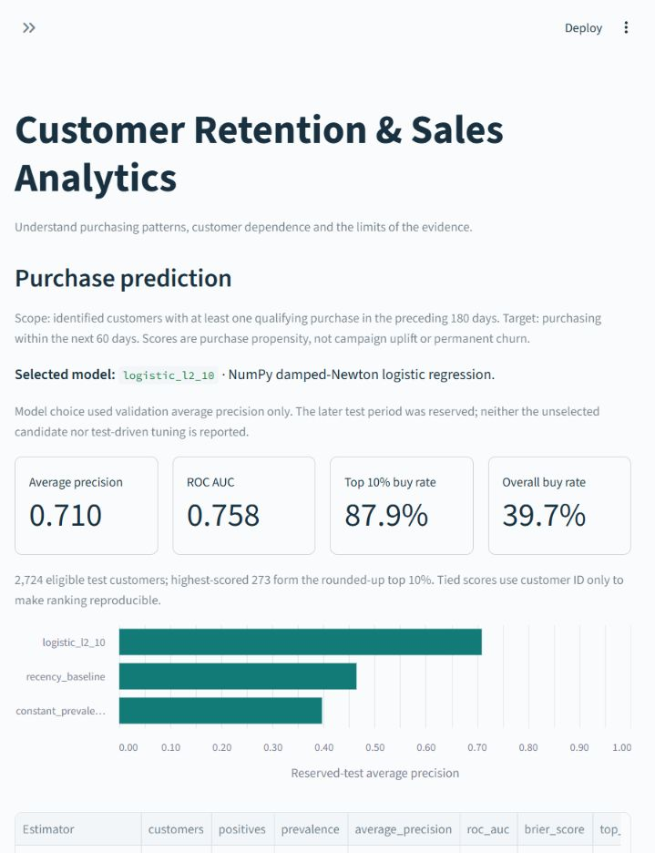

# Customer Retention & Purchase Prediction

**Retail analytics with Python, SQL, NumPy and Streamlit**

Which customers return, how concentrated are sales, and who is likely to purchase again? This project explores those questions using **1.07 million retail invoice lines**, combining SQL analysis, an interactive dashboard and a model evaluated on later time periods.

[](https://github.com/mrqiyangsun-coder/customer-retention-analytics/actions/workflows/ci.yml)

[Business findings](reports/business_memo.md) · [Model evaluation](reports/prediction_assessment.md) · [Robustness & reliability](reports/release_evaluation.md) · [Download v1.0.0](https://github.com/mrqiyangsun-coder/customer-retention-analytics/releases/tag/v1.0.0)

## What the analysis shows

| Question | Finding |
|---|---|
| How did sales change? | January–November 2011 recorded **1.8% more positive sales value** than the same months in 2010, with **4.6% fewer orders** and **6.7% higher average order value**. |
| How dependent is the retailer on its largest customers? | The top **588 of 5,878 identified customers** accounted for **63.8%** of identified positive sales value. |
| Can purchase history improve customer ranking? | On the July 2011 test snapshot, the model achieved **0.710 average precision** versus **0.464** for the recency baseline, with **0.758 ROC AUC** across **2,724 eligible customers**. |

Sales value here means positive recorded charges before deducting refunds. Customer concentration uses identified customers only. Model scores estimate purchase propensity; they do not measure the effect of sending an offer.

## Explore the dashboard

The five views connect the business questions to the underlying evidence:

- **Sales overview:** filter complete months and inspect sales, order counts, average order value and customer contribution.
- **Customer cohorts:** compare purchasing activity by first observed purchase month, with unobserved follow-up kept distinct from zero activity.
- **Customer concentration:** examine how recorded value is distributed across identified customers.
- **Purchase prediction:** compare the model with baselines and inspect performance and probability reliability across time.
- **Definitions & downloads:** review metric definitions, source provenance and supporting tables.



[Run the dashboard locally](#run-locally). Saved reports are included, so viewing it does not require downloading the original workbook or training a model.

## From source data to evidence

**Source audit → documented cleaning → SQLite & SQL analysis → customer features → temporal evaluation → dashboard**

The pipeline reconciles **22,523 cross-export copies** into **40,077 qualifying orders**, while retaining adjustment records and anonymous sales for traceability. Identified-customer orders cover **84.89%** of positive recorded value. [Cleaning rules](docs/cleaning_rules.md) and the [data dictionary](docs/data_dictionary.md) document the choices and coverage.

### Prediction design

- **Population:** identified customers with a qualifying purchase in the preceding 180 days.
- **Target:** at least one qualifying purchase in the next 60 days.
- **Features:** past recency, order frequency, recorded value, average order value and observed tenure. Customer IDs and future orders are excluded from model inputs.
- **Chronology:** train at July 2010, choose between two fixed regularization settings using January 2011 validation, then evaluate on July 2011. Preprocessing is fitted on training data only.
- **Comparisons:** constant-prevalence and recency baselines; average precision, ROC AUC, Brier score and top-decile purchase rate.

The same fitted model was subsequently evaluated at fixed April and September 2011 cutoffs, with average precision of **0.673** and **0.748**, respectively. Both exceed their recency baselines. Probability reliability changes across periods: September's ten-bin calibration error is **0.090**. The [robustness report](reports/release_evaluation.md) includes reliability bins, conditional bootstrap intervals and cleaning-sensitivity scenarios.

## Run locally

Use **Python 3.12**. No API key or paid service is required.

<details open>
<summary><strong>Windows PowerShell</strong></summary>

From the repository root:

```powershell
python -m venv .venv
.\.venv\Scripts\python.exe -m pip install -r requirements-lock.txt
.\.venv\Scripts\python.exe -m streamlit run streamlit_app.py --server.address 127.0.0.1
```

</details>

<details>
<summary><strong>macOS / Linux</strong></summary>

```bash
python3.12 -m venv .venv
.venv/bin/python -m pip install -r requirements-lock.txt
.venv/bin/python -m streamlit run streamlit_app.py --server.address 127.0.0.1
```

</details>

Open **http://127.0.0.1:8501** and leave the terminal running. Stop with Ctrl+C.

To run the checks or reproduce the complete pipeline:

```powershell
.\.venv\Scripts\python.exe -m unittest discover -s tests -v
.\.venv\Scripts\python.exe run_pipeline.py
```

On macOS/Linux, substitute `.venv/bin/python`. Reproduction downloads the attributed public workbook on first run and can take several minutes. Raw data, derived databases and fitted model artifacts stay under the ignored `data/` directory. The published project has **54 automated tests** covering data rules, time boundaries, numerical metrics and dashboard interactions.

## Interpretation and limits

These are historical records from a UK gift retailer, including wholesalers. First observed purchase is not necessarily acquisition, and a period without purchasing does not establish permanent churn. Anonymous and long-inactive customers are outside model eligibility; customers may recur across evaluation periods. The reported bootstrap intervals are conditional on the fitted model and individual window.

The analysis supports investigation of purchasing patterns and customer dependence. A randomized outreach experiment would be needed to establish incremental purchases or marketing return. Positive recorded value is not profit or established refund-net revenue.

<details>
<summary><strong>Implementation notes and repository guide</strong></summary>

Logistic regression uses a NumPy damped-Newton optimizer with training-standardized log1p features, an unpenalized intercept and explicit gradient convergence checks. Fixed L2 penalties 1 and 10 were compared on validation average precision. The NumPy implementation followed a development-environment restriction on SciPy's compiled dependency; no scikit-learn benchmark is claimed.

| Files | Purpose |
|---|---|
| `download_data.py`, `audit.py`, `clean.py` | Source provenance, audit and analytical dataset |
| `sql/`, `analysis.py`, `charts.py` | Business metrics, cohorts, concentration and charts |
| `prediction.py`, `release_evaluation.py` | Past-only features, model evaluation, reliability and sensitivity |
| `streamlit_app.py`, `dashboard_data.py` | Interactive report dashboard |
| `tests/`, `.github/workflows/ci.yml` | Regression tests and automated checks |
| `reports/`, `docs/` | Findings, metric definitions and supporting evidence |
| `run_pipeline.py`, `package_release.py` | Reproduction and standalone release packaging |

Developed with AI coding assistance. The documented results describe the implemented project and its evaluation.

</details>

## Data and attribution

Chen, D. (2012). **Online Retail II**. UCI Machine Learning Repository. [DOI: 10.24432/C5CG6D](https://doi.org/10.24432/C5CG6D).

Dataset and derived reports: **CC BY 4.0**. Project code: **MIT**. See [NOTICE](NOTICE) and [LICENSE](LICENSE).
