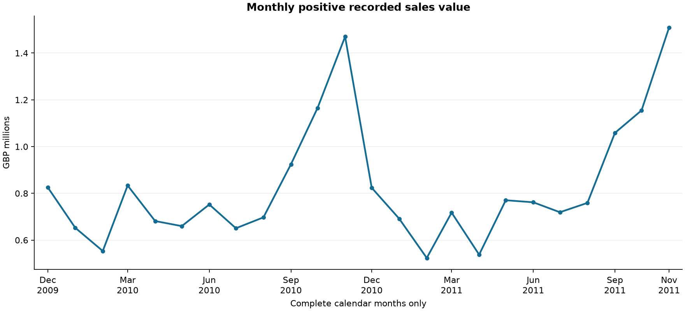
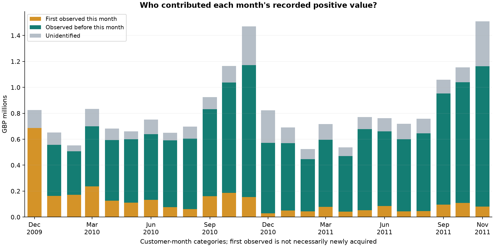
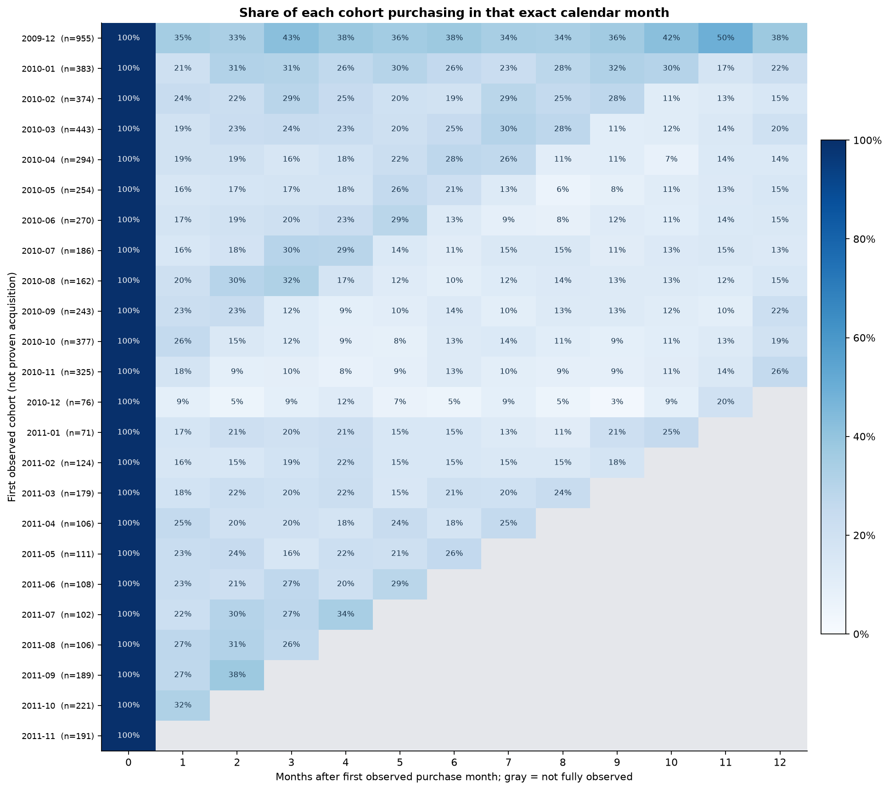
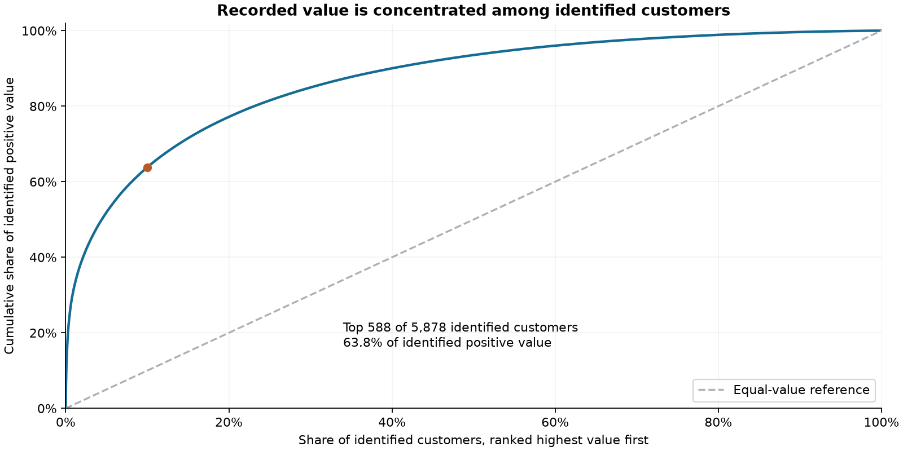

# First business analysis memo

## Scope

Historical UK retail records, December 2009-December 2011. Results use the documented version 1 positive-purchase definition. Values are GBP recorded positive charges, not net revenue or profit. No causal effect is estimated.

## Findings

1. Comparing the same complete calendar months (01, 02, 03, 04, 05, 06, 07, 08, 09, 10, 11) in 2010 and 2011, positive value changed from GBP 9,041,353.61 to GBP 9,204,145.72 (+1.8%). Orders changed from 18,435 to 17,582 (-4.6%). These are matched-period comparisons, not full-year growth claims.
   Average positive order value changed from GBP 490.45 to GBP 523.50 (+6.7%). This describes the value/order-count decomposition; it does not establish a price increase or explain changes in customer/product mix.

2. The latest complete month, 2011-11, recorded GBP 1,509,496.33. Month-over-month change was +30.7%; the same-month prior-year change was +2.7%. Seasonal and year-over-year context must accompany short-term changes.
   Customers observed before that month supplied 93.0% of identified-customer value. Customers in their first observed month include any purchases within that month. This is not proof of true acquisition or improving causal retention.

3. The top 588 of 5,878 identified customers (the rounded-up top 10%) account for 63.8% of identified positive value across observed histories. Anonymous sales are outside that denominator; customers also have unequal history lengths.

4. Among 4,704 customers in 22 cohorts with a fully observed following calendar month, excluding the initial dataset cohort, 990 (21.0%) purchased in that next month. This measures exact-month activity, not continuous survival or permanent churn. The initial cohort is excluded from this aggregate because it is especially left-truncated.

## Decisions and next investigations

- Monitor matched-month sales and order counts together. Inspect customer and country mix before assigning a cause to any change.
- Investigate dependence on large identified customers; use a later time window to check whether concentration persists.
- Use mature cohort patterns to form retention hypotheses. Design a randomized outreach/offer experiment before claiming an intervention improves purchases; purchase propensity alone does not identify treatment uplift.
- Quantify sensitivity to adjustment treatment, charges and within-sheet repeats before making financial decisions.

## Coverage and limitations

- Partial months excluded from trend comparisons: 2011-12.
- Customer analyses cover identified orders only. The cleaning report documents the sales-value coverage of that subset.
- First observed purchase is not necessarily acquisition. Monthly customer mix changes partly as the observation window accumulates history.
- Cohort charts omit partial/future windows; an observed inactive month is zero, but an unobserved month is blank.
- Cohort activity allows customers to leave and return; it does not require uninterrupted monthly purchases.
- The historical retailer includes wholesalers. These associations do not establish current-market behavior or causal explanations.

## Figures

## Reproduce

Run `.\.venv\Scripts\python.exe analysis.py` from the project folder. SQL sources are in `sql/02_monthly_analysis.sql`, `sql/03_cohort_activity.sql` and `sql/04_customer_concentration.sql`. CSV files contain all computed values, including partial months labeled explicitly.
