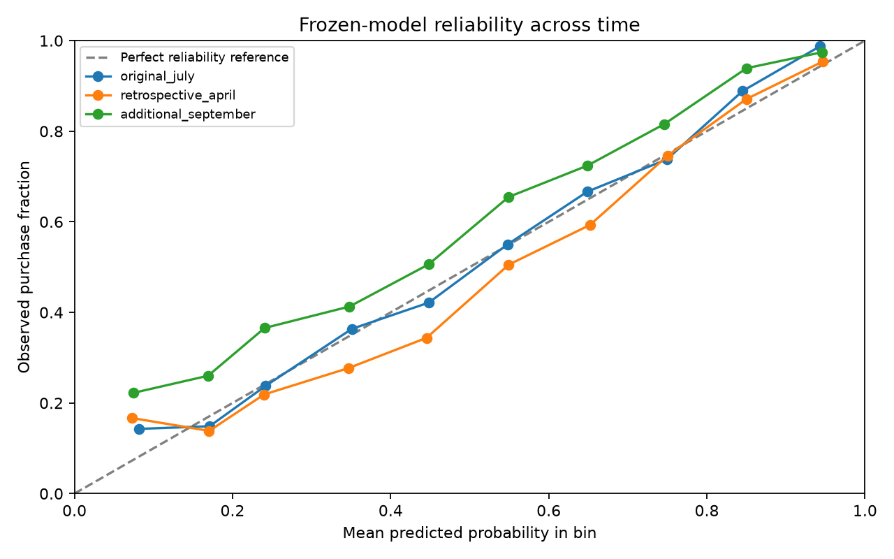

# Release 1.0 robustness and sensitivity

## Frozen evaluation protocol

The original July test was already observed before this finalization. Model settings, features, preprocessing, baselines and eligibility are unchanged. April and September windows were fixed in the finalization plan before calculating their results. April is retrospective robustness; September is additional later evidence, not a replacement for the original test. No result here was used to tune or select a model.

| Window cutoff | Eligible customers | Purchase rate | Model AP | Recency AP | Model AUC | Brier | ECE (10 bins) |
|---|---:|---:|---:|---:|---:|---:|---:|
| 2011-07-01 | 2,724 | 39.7% | 0.710 | 0.464 | 0.758 | 0.188 | 0.015 |
| 2011-04-01 | 3,304 | 35.0% | 0.673 | 0.430 | 0.754 | 0.182 | 0.043 |
| 2011-09-01 | 2,772 | 49.1% | 0.748 | 0.550 | 0.728 | 0.216 | 0.090 |

## Conditional uncertainty and reliability

Fixed 500-resample paired customer bootstraps compare AP with the recency baseline separately in each window. Customers recur across windows; do not pool snapshots as independent observations. These percentile intervals condition on the fitted model and do not measure seasonal or training-set uncertainty.

- 2011-07-01: AP difference +0.245; conditional 95% percentile interval [+0.225, +0.268].
- 2011-04-01: AP difference +0.243; conditional 95% percentile interval [+0.220, +0.266].
- 2011-09-01: AP difference +0.198; conditional 95% percentile interval [+0.179, +0.215].

Reliability uses ten fixed equal-width bins. Compare mean probability with observed rate and inspect counts; empty bins stay empty. ECE is sample/bin dependent, not proof that probabilities are calibrated. No calibration correction was fitted or selected from these outcomes.

## Cleaning sensitivity

- Current positive recorded value: GBP 20,533,741.92.
- Removing retained copies with identical normalized source fields within each sheet: GBP 20,476,260.45 (-0.28%); removes 11,741 purchase occurrences.
- Summing signed valid charges/credits as a bookkeeping scenario: GBP 18,909,762.12 (-7.91% versus the positive-only metric).

Neither scenario is a corrected ground truth. Repeated invoice lines may be legitimate; normalized-field identity can collapse text formatting differences. Signed entries are not matched refunds, merchandise-only revenue or profit. The original cleaning policy and primary model target remain unchanged; this checks aggregate value sensitivity, not a refitted model under alternative cleaning.

## Decision

Use the project as reproducible historical analytics and a purchase-ranking study. Inspect reliability before treating scores as purchase probabilities; conduct a randomized outreach experiment before claiming incremental value. More retailers, time periods and operational validation are needed for production use.

Reproduce with `python release_evaluation.py` after `prediction.py`. Inputs are checksum-checked against the frozen model reports. No model training occurs in this step.
